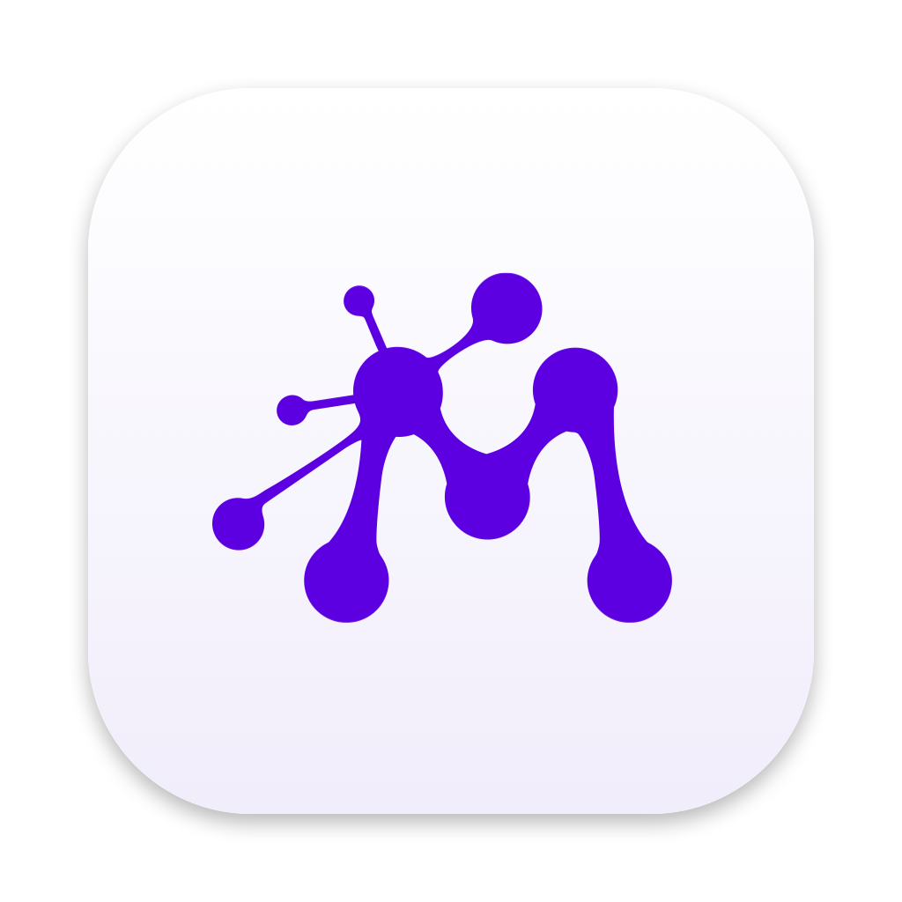
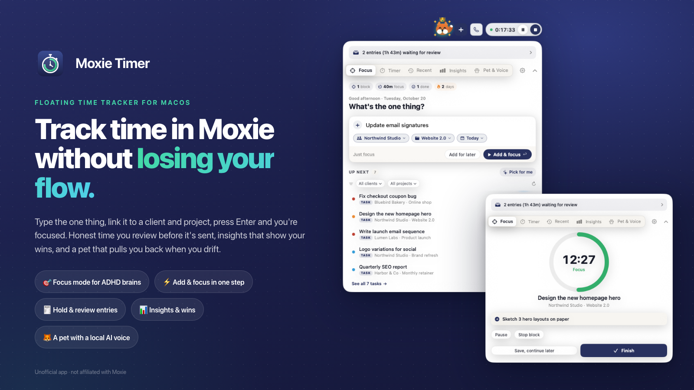
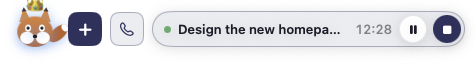
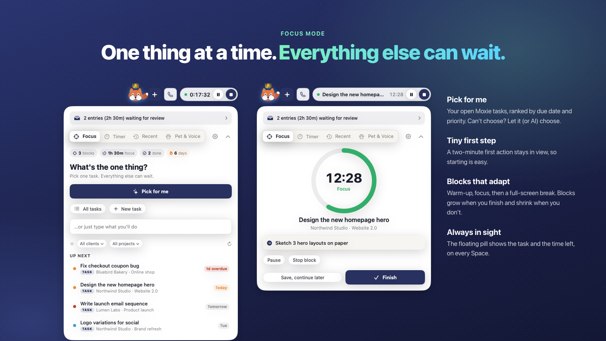
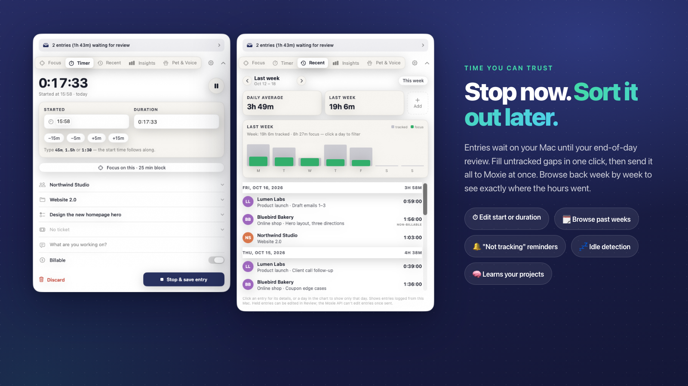
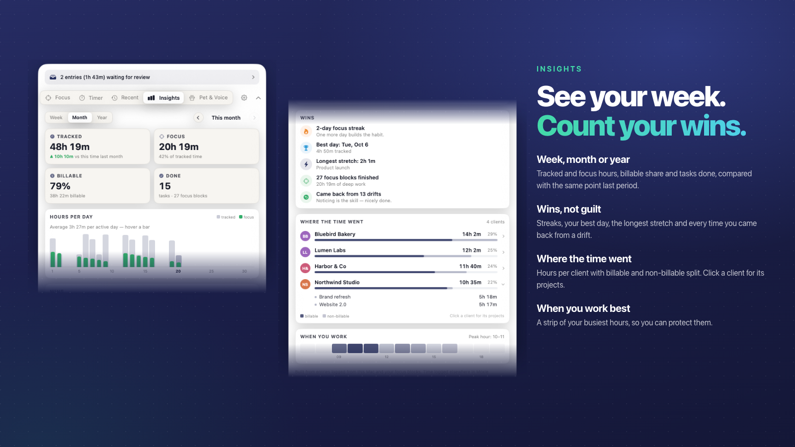
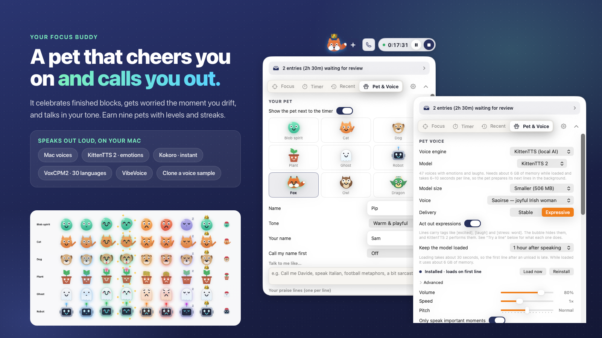
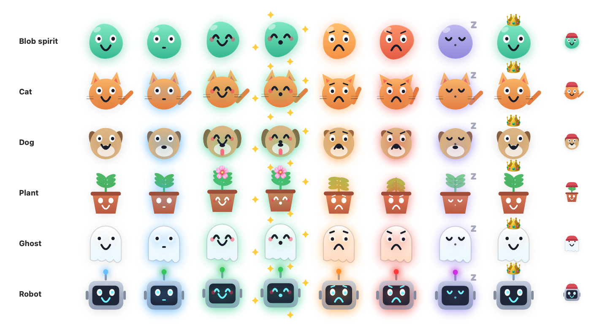

<div align="center">



# Moxie Timer

**A floating time tracker for macOS that logs straight to [Moxie](https://www.withmoxie.com) and keeps you focused while you work.**

[](https://github.com/flyingwebie/moxie-timer/releases/latest)




</div>

> [!IMPORTANT]
> **This is NOT an official Moxie product.** It's an independent, unofficial widget with no affiliation with or endorsement
> from Moxie, and it comes with no warranty. The authors take no responsibility for its use. See the [Disclaimer](#disclaimer).

## Why

Opening a browser tab to start a timer is exactly the moment you get distracted. Moxie Timer lives in a small pill
that floats above your work on every Space:

<p align="center"></p>

Click it and you get a card with everything you need: name the one thing, focus on it, log honest time, and send it to
Moxie when you're ready. It's built for people who lose track easily, ADHD brains included.

- ⏱ **One-click timer:** start, pause and stop from the pill or the menu bar. A running timer survives quitting.
- 🎯 **Focus mode:** type a task, link it to a client and project, press Enter and you're focused. One task at a
  time, a tiny first step, adaptive focus blocks and real breaks.
- 🧾 **Time you can trust:** entries wait for your end-of-day review, with gap filling and "not tracking" reminders.
- 📊 **Insights:** hours, focus, billable share and wins by week, month or year, and where the time went per client.
- 🦊 **A pet that keeps you on track:** it celebrates, worries when you drift, and can talk with a local AI voice.
- 📞 **Calls aware:** breaks, nudges and the pet wait while you're on a call, and the timer keeps going.
- 🔒 **Local first:** your history, learned projects and AI voices stay on your Mac.

## Focus mode



How it works:

1. **Type the one thing.** The box at the top of the Focus tab is the main action. Pick a **client**, **project** and
   **due date** right there (searchable chips), then press **Enter**: **Add & focus** creates the task in Moxie,
   assigned to you, and starts focusing on it. **Add for later** adds it to Up next instead, and **Just focus** starts
   without creating a Moxie task. When Up next is filtered, the box starts from that client and project, so new tasks
   land where you're looking.
2. **…or take it from Up next.** Your open Moxie tasks and tickets, ranked by overdue, due soon, priority and age, and
   filtered by client or project. Tasks you just added stay pinned on top with a **NEW** badge. Hover a task and click
   to focus on it, or let **Pick for me** choose (with AI if you turn it on).
3. **Tiny first step**, then **focus in adaptive blocks** (below).

More detail:

- **Tiny first step:** write, or let AI suggest, a 2-minute first action. It stays visible while you work.
- **Adaptive blocks:** a 5-minute warm-up, then focus. The suggested length grows after a block you finish and shrinks
  after one you stop early (15–90 min). When it ends, a full-screen break appears (snooze once for 5 min).
- **Always in sight:** the pill shows the task and the time left. **Focus on this** turns a plain timer into a block
  without losing the time already tracked.
- **Quick capture:** press **⌃⌥Space** anywhere to add a task straight to Moxie, assigned to you. **Add & focus now**
  is the main button (Enter); **Add for later** keeps it in Up next.
- **Staying on task:** mark distracting apps and sites. Drift to one and the pill turns amber with "Back to: *task*",
  then a notification, then a prompt: **Back to it**, **Back, drop N min**, **Take a break** or **It's for work**.
  Optional check-ins ask "Still on *task*?" every 20 minutes.
- **Finish** saves the time and clears the task from Up next. Closing tasks and tickets in Moxie from the widget is
  opt-in (Settings → Focus).

## Time you can trust



- **Hold for review (default):** stopping keeps the entry on your Mac, so you can stop now and choose the client or
  project later. At your review time (default 17:30) **Review & send** shows held entries per day and the **untracked
  gaps** in your work hours, which you can fill with one click. Then everything goes to Moxie at once.
- **Edit as you go:** ±5/±15 minute nudges, and type a start time or a duration (`45m`, `1.5h`, `1:30`).
- **Client → project → task → ticket** pickers load live from Moxie, with search and a Billable switch.
- **Recent, week by week:** step back through past weeks with the arrows. The totals, the chart (focused part
  highlighted) and the entry list all follow the week you're viewing; click a day in the chart to list only that day.
  Click an entry for all its details: times, project, task, notes, billable, whether it was sent, and its Moxie ID.
- **"Not tracking" reminders:** active during work hours with no timer? The pill turns amber after 1 minute, a
  notification arrives after 2, and a prompt after 5. Starting from it back-dates the timer to when you began.
- **Idle detection:** come back after time away (or sleep) and keep or discard that time.
- **Project suggestions:** the app learns which apps (and, with Accessibility permission, which window titles) go with
  which client or project, and suggests them. The learned data stays in a local file.

## Insights



A calm look back that counts what went right. Switch between **week**, **month** and **year**, and go back with the
arrows.

- **The numbers:** tracked hours, focus hours (and their share of tracked time), billable share, tasks done and focus
  blocks. Tracked time is compared with the same point last period, so Tuesday afternoon is set against last Tuesday
  afternoon, not a whole week.
- **Hours per day** (per month in the year view), with the focused part highlighted. Hover a bar for its numbers.
- **Wins:** your focus streak, best day, longest stretch, focus blocks finished and every drift you came back from.
- **Where the time went:** hours per client with the billable part shown in the bar. Click a client for its projects.
- **When you work:** a strip of your busiest hours of the day.

It's built from the entries logged from this Mac and your focus blocks; time logged elsewhere in Moxie isn't included.

## Your pet



Start with the **blob spirit** and earn more as you level up and keep streaks: cat (Level 2), dog (2-day streak),
plant (Level 3), ghost (3-day streak), robot (Level 5), fox (Level 7), owl (5-day streak) and dragon (Level 10).
It sits next to the pill, glows when you finish blocks and tasks, gets worried the moment you drift and stern if you
stay there, sleeps during breaks, and talks to you in a speech bubble.

- **Mood, levels and a wardrobe:** XP (about 1 per focused minute, plus bonuses) unlocks a sparkle, bow, sprout,
  beanie, scarf, crown and halo. Click the pet for its mood, level and today's stats.
- **Skills: who the pet is and how it reacts.** Pick a **persona** (Coach, Hype friend, Calm mentor, Drill sergeant,
  Dry sarcastic, Italian nonna, Quiet, or your own), or let **Surprise me** pick a different one each day. Add
  **situation rules** that change its lines when something is true: morning start, late night, Monday morning or
  Friday afternoon, task due today, 90+ minutes without a break, a rough patch of drifts, a great run, or a long time
  away. Up to two rules apply at once, in the order you set. Settings → Pet → **Manage skills…** opens the editor,
  with example lines per moment (with `{task}`, `{app}`, `{level}`, `{streak}`) and a preview that writes sample lines.
  Skills are Markdown files in `~/Library/Application Support/MoxieTimer/Skills`, so you can edit and share them.
- **Fresh lines every day:** with AI on, the pet rewrites 8 lines per moment for your persona and 4 for each situation
  rule once a day (and soon after you edit a skill), trying the "Write with" engine first (Claude Code CLI by
  default). Lines stay instant and work offline. Big moments also get a line written on the spot from the time of day,
  today's progress, the task's due date and what the pet said recently. It never repeats a line on the same day while
  it has others to say.

<p align="center"></p>

### A voice of its own

The pet can say its lines out loud, every line or only the important moments, and never during calls.

| Voice | Runs on | Good at | Memory while loaded |
| --- | --- | --- | --- |
| **Mac voices** | Built in | Works right away; Premium/Enhanced voices sound best | — |
| **KittenTTS 2** | Local AI | 47 voices that act out emotions, sounds and stress | ~6 GB |
| **KittenTTS Mini/Micro/Nano** | Local AI | Tiny and instant, no expressions | ~0.4 GB |
| **Kokoro** | Local AI | 28 English voices, almost instant, can copy a voice from a recording | ~1.5 GB |
| **VoxCPM2** | Local AI | 30 languages; describe the voice you want or copy one; emotions as style | ~5–6 GB |
| **VibeVoice** | Local AI | Very natural English, copies a recording (research release) | ~4–5 GB |

- **One click to install:** each local voice gets its own Python environment in `~/.moxie-timer/voice` (uses `uv` if
  you have it). Models download to `~/.cache/huggingface`. Nothing is sent anywhere.
- **Slow voices still feel instant:** the pet writes and voices its next line for each moment in the background.
- **Copy a voice:** give Kokoro, VoxCPM2 or VibeVoice 5–30 seconds of one person speaking (any audio file, Voice
  Memos too). Only use a voice you have permission to copy.
- **Voice tags** in square brackets: an emotion at the start (`[joyful]`, `[stern]`…), a sound anywhere (`[laugh]`,
  `[sigh]`, `[pause]`…) and `[stress: word]`. The bubble hides them, and **Try a line** shows only the tags the
  selected voice understands.
- **Voice models on this Mac** lists every installed voice with its size, shows which model is loaded and how much
  memory it uses, and removes a voice in one click.
- **Call my name first:** with your name and a hot word, nudges open with "Sam, listen up!" in the line's emotion.

AI for picking tasks and writing lines (Settings → AI) is tried in your order: Apple on-device (macOS 26 with Apple
Intelligence), Ollama, then the Claude Code, Codex or Gemini CLIs with your existing subscriptions.

## Calls

While another app uses the microphone (Zoom, Google Meet in a browser, Teams, Slack huddles, FaceTime…) you're
**in a call**: the timer keeps tracking, but the break screen, drift nudges, check-ins, idle prompts and pet bubbles
wait. A break that comes due during the call appears when it ends. No permission is needed: macOS only reports *that*
the mic is in use and by which app, never audio. Always-on recorders and dictation apps can be ignored, and there's an
**I'm in a call** switch for anything detection misses.

## Download

Grab the latest `MoxieTimer-x.y.z.zip` from [Releases](https://github.com/flyingwebie/moxie-timer/releases/latest),
unzip, and move it to /Applications. It's signed with an Apple Developer ID and notarized by Apple, so it opens
without Gatekeeper warnings.

It updates itself from GitHub Releases: a banner offers **Install & relaunch**, and a running timer carries over.

## Setup

1. In Moxie, open **Custom API** and choose **Enable**.
2. Copy the API key and the **workspace base URL** (e.g. `https://pod00.withmoxie.dev/api/public`) into the widget's Settings.
3. Enter the email of the Moxie user the time belongs to, or pick it from the workspace users list.
4. Press **Test connection**.

The API key is stored in the macOS Keychain.

<details>
<summary><b>Build from source</b></summary>

Requires macOS 14+ and Xcode 16+ (Swift 5.10+). Build with Xcode 26+ to include Apple's on-device AI engine.

```sh
./scripts/build-app.sh            # → build/MoxieTimer.app
./scripts/build-app.sh --install  # copies to /Applications and launches
./scripts/build-app.sh --notarize # also notarizes and staples (needs NOTARY_PROFILE)
```

Add `--universal` for an Apple Silicon + Intel binary. For development you can also `open Package.swift` in Xcode and
run the `MoxieTimer` scheme. Local builds are signed with the first "Developer ID Application" certificate in your
keychain (ad-hoc when there's none, or with `--adhoc`), so permissions survive rebuilds. To notarize locally, save your
credentials once with `xcrun notarytool store-credentials moxie-notary` and pass `NOTARY_PROFILE=moxie-notary`.

</details>

<details>
<summary><b>API limitations</b></summary>

| Moxie web widget | This widget | Why |
| --- | --- | --- |
| Billable toggle | Sent as `billable` (not in the documented schema) | The app checks the saved entry Moxie returns and tells you if the toggle was ignored. If Moxie rejects the field, the entry is saved again without it |
| Ticket link | Added to the entry's notes as `Ticket #123 …` | No ticket field on time entries |
| Recent list / edit entry | Local log of entries sent from this Mac | The API can't list, edit or delete time entries |
| Client logos | Initials | Not returned by `clients/list` |

Pauses are left out of the logged time. An entry is saved as one block that ends when you stop, and its start is
`end − tracked duration`.

Endpoints used: `clients/list`, `projects/search`, `tasks/list`, `tasks/create`, `tasks/update`, `taskStages/list`,
`tickets/list`, `users/list`, `timeWorked/create`.

Marking a task complete sets it to the project type's "complete" stage via `tasks/update`. That endpoint accepts any
task fields but isn't fully documented, so the app checks Moxie's reply and tells you if the change wasn't confirmed.

</details>

<details>
<summary><b>Signing, local data and updates</b></summary>

Releases are signed with a Developer ID certificate and notarized by Apple (the certificate and notary credentials are
encrypted GitHub secrets), so macOS keeps the app's Keychain and Accessibility permissions across updates. The updater
only installs updates signed by the same certificate or by the project's Developer ID team.

Local entries (`~/Library/Application Support/MoxieTimer/history.json`) are backed up once a day, keeping 14 days;
restore from Settings → Local data. Restoring merges missing entries back without overwriting newer ones. AI-written
pet lines live in `pet-skill-lines.json` and the pet's skills in `Skills/` in the same folder.

On launch and every 6 hours, the app checks this repo's latest GitHub release. If the tag (`v1.2.0`) is newer than the
installed version, it downloads `MoxieTimer-<version>.zip`, checks it against the `.sha256` file, swaps the app bundle
in place and reopens it. You can also check manually in Settings or from the menu bar, or turn automatic checks off.
The app has to be somewhere it can write to, such as /Applications, and not opened straight from Downloads.

</details>

<details>
<summary><b>Releasing</b></summary>

```sh
./scripts/release.sh 1.2.0
```

This starts the **Release** workflow on GitHub. It builds a universal app, creates tag `v1.2.0`, and publishes
`MoxieTimer-1.2.0.zip` with a SHA-256 file. You can also run the workflow from the Actions tab or push a `v*` tag.
Installed copies offer the update automatically.

</details>

<details>
<summary><b>Icon and images</b></summary>

The app icon is original artwork (`Support/AppIcon.svg`). It doesn't use any Moxie logo or brand asset. Run
`swift scripts/make-icon.swift` to rebuild `Support/AppIcon.icns` from it.

The screenshots in `docs/images` are of the real app with made-up demo data (Northwind Studio, Bluebird Bakery and
friends are fictional). `scripts/marketing/render.sh` regenerates `hero`, `focus`, `time` and `insights`: it builds the
app's views with demo data in a throwaway home folder (your real data, settings and Keychain are never touched),
briefly shows each screen in a corner of your display to capture it, and lays out the 1600×900 images with headless
Chrome. Layouts live in `scripts/marketing/*.html`; `compose.sh` re-lays them out from saved captures.

</details>

## Disclaimer

**Moxie Timer is an unofficial, independent project. It is not made, endorsed, sponsored or supported by Moxie
(withmoxie.com) or its owners.** "Moxie" is a trademark of its owner and is used here only to describe what the app
works with.

This software is provided "as is", without warranty of any kind. The authors accept no responsibility or liability for
any loss of data, incorrect or missing time entries, billing errors, or any other damage arising from its use.
Use it at your own risk and check your time entries in Moxie.
